# Taskly — Gestor de tareas

Aplicación web para gestionar tareas construida con **HTML + CSS + JavaScript puro**, usando **Web Components con Shadow DOM**, persistencia en **localStorage (JSON)** e importación de tareas desde la API pública [JSONPlaceholder](https://jsonplaceholder.typicode.com/todos).

Sin frameworks, sin dependencias y sin paso de compilación.

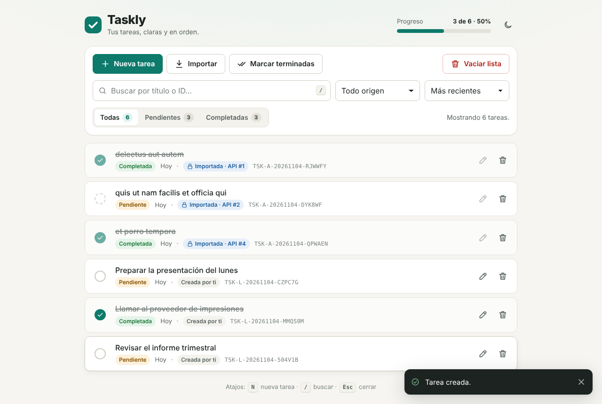

---

## Índice

1. [Funcionalidades](#funcionalidades)
2. [Instrucciones de uso](#instrucciones-de-uso)
3. [Ejecución local](#ejecución-local)
4. [Despliegue](#despliegue)
5. [Estructura del proyecto](#estructura-del-proyecto)
6. [Lógica implementada](#lógica-implementada)
7. [Accesibilidad y UX](#accesibilidad-y-ux)
8. [Wireframes](#wireframes)
9. [Compatibilidad](#compatibilidad)

---

## Funcionalidades

| Requerimiento | Implementación |
|---|---|
| Lista de tareas como vista inicial | `<task-list>` muestra título, estado (completada / pendiente), fecha de registro, origen e ID. |
| Crear, actualizar y eliminar | Botón **Nueva tarea**, lápiz de cada fila (editar) y papelera (eliminar con opción **Deshacer**). |
| Importar tareas | Botón **Importar** → modal con el banco de tareas de la API. |
| Marcar tareas como terminadas | Botón **Marcar terminadas**: completa todas las tareas pendientes **visibles** (respeta búsqueda y filtros), con confirmación y **Deshacer**. Cada fila tiene además su propia casilla. |
| Vaciar la lista | Botón **Vaciar lista** con diálogo de confirmación y **Deshacer**. |
| Filtro por estado | Control segmentado *Todas / Pendientes / Completadas* con contadores. Extra: filtro por origen y ordenación. |
| Buscador | Búsqueda instantánea por título o ID, sin distinguir mayúsculas ni tildes, con resaltado de coincidencias. |
| Formulario en modal | `<task-form-modal>`: título, fecha de registro y completado. Solo aparece al crear o editar. |
| Importación (1 o varias) | Selección individual o "Seleccionar visibles", búsqueda y filtros dentro del modal. |
| Identificadores propios | Estándar `TSK-{ORIGEN}-{AAAAMMDD}-{ALEATORIO}` (ver abajo). |
| Importadas: solo eliminar | Casilla y botón de edición bloqueados; el store rechaza cualquier modificación. |
| Web Components + Shadow DOM | 8 custom elements, todos con `attachShadow({ mode: 'open' })`. |
| Persistencia JSON | `localStorage["taskly:tasks"]` con esquema versionado. |
| Manejo de errores de la API | Sin conexión, tiempo agotado, error HTTP, JSON inválido o formato inesperado, con botón **Reintentar**. |
| Diseño responsive y accesible | Móvil, tablet y escritorio; tema claro/oscuro; navegable por teclado y lector de pantalla. |

---

## Instrucciones de uso

### Crear una tarea
1. Pulsa **Nueva tarea** (o la tecla <kbd>N</kbd>).
2. Escribe el título (3–200 caracteres). La fecha de registro es hoy por defecto; puedes cambiarla, pero no a una fecha futura.
3. Activa **Completada** si ya está terminada y pulsa **Crear tarea** (o <kbd>Enter</kbd>).

### Editar o completar
- Marca la casilla circular de una fila para alternar *pendiente / completada*.
- Pulsa el lápiz para abrir el formulario de edición.

### Eliminar y deshacer
- Pulsa la papelera. Aparece un aviso con **Deshacer** durante unos segundos.

### Importar desde la API
1. Pulsa **Importar**. Se cargan las 200 tareas del banco público.
2. Filtra por texto, estado o usuario y marca una o varias tareas (o **Seleccionar visibles**).
3. Pulsa **Importar N**. Las tareas se guardan junto a las tuyas con un identificador nuevo `TSK-A-…`.
4. Las tareas importadas llevan un candado: **no se pueden editar ni cambiar de estado, solo eliminar**. Las que ya importaste aparecen deshabilitadas en el modal para evitar duplicados.

### Buscar y filtrar
- Escribe en el buscador (atajo <kbd>/</kbd>, <kbd>Esc</kbd> para limpiarlo).
- Usa *Todas / Pendientes / Completadas*, el filtro de origen (*Creadas por mí / Importadas*) y el orden. Los filtros se recuerdan entre visitas.

### Acciones masivas
- **Marcar terminadas** completa las tareas pendientes que estás viendo (las importadas se omiten y se indica cuántas).
- **Vaciar lista** elimina todo tras confirmar; puedes deshacerlo durante 8 segundos.

### Atajos de teclado

| Tecla | Acción |
|---|---|
| <kbd>N</kbd> | Nueva tarea |
| <kbd>/</kbd> | Ir al buscador |
| <kbd>Enter</kbd> | Guardar el formulario |
| <kbd>Esc</kbd> | Cerrar modal / limpiar búsqueda |

---

## Ejecución local

La aplicación usa **módulos ES** (`<script type="module">`). Los navegadores los bloquean cuando el archivo se abre con doble clic (`file://`), así que hay que servir la carpeta con cualquier servidor estático. Si se abre con `file://`, la propia página muestra un aviso con estas instrucciones.

Elige una opción desde la carpeta del proyecto:

```bash
# Opción 1 — Python 3 (preinstalado en la mayoría de sistemas)
python -m http.server 5500

# Opción 2 — Node.js
npx serve .

# Opción 3 — PHP
php -S localhost:5500
```

Luego abre <http://localhost:5500>.

**Opción 4 — VS Code:** instala la extensión *Live Server*, haz clic derecho sobre `index.html` → *Open with Live Server*.

> Se necesita conexión a internet solo para el modal de importación (la API es externa). El resto funciona sin conexión.

---

## Despliegue

Es un sitio 100 % estático: basta con publicar la carpeta tal cual.

### GitHub Pages
1. Sube el proyecto a un repositorio de GitHub.
2. *Settings → Pages → Build and deployment* → *Deploy from a branch*.
3. Selecciona la rama `main` y la carpeta `/ (root)`. En uno o dos minutos estará en `https://<usuario>.github.io/<repositorio>/`.

### Netlify
- Arrastra la carpeta del proyecto a <https://app.netlify.com/drop>, o conecta el repositorio sin comando de build y con *Publish directory* = `.`.

### Vercel
```bash
npx vercel --prod
```
Framework preset: *Other*, sin comando de build.

Todas las rutas internas son relativas, por lo que funciona también en subcarpetas (como GitHub Pages de proyecto).

---

## Estructura del proyecto

```
proyecto_web/
├── index.html                    Punto de entrada; monta <task-app>
├── css/
│   └── styles.css                Design tokens (variables CSS), tema claro/oscuro, estilos base
├── js/
│   ├── app.js                    Arranque: registra los Web Components
│   ├── components/               Web Components (cada uno con su Shadow DOM)
│   │   ├── task-app.js           Raíz: orquesta store ⇄ vista, atajos, tema
│   │   ├── task-toolbar.js       Acciones, buscador, filtros y orden
│   │   ├── task-list.js          Lista con reconciliación por id y estados vacíos
│   │   ├── task-item.js          Fila de tarea
│   │   ├── task-form-modal.js    Modal crear/editar con validación
│   │   ├── import-modal.js       Modal de importación desde la API
│   │   ├── confirm-dialog.js     Confirmación basada en promesas
│   │   ├── toast-region.js       Notificaciones con "Deshacer"
│   │   └── shared-styles.js      Hojas de estilo compartidas (adoptedStyleSheets)
│   ├── store/
│   │   └── task-store.js         Estado, reglas de negocio y eventos
│   ├── services/
│   │   ├── api.js                Cliente de JSONPlaceholder con manejo de errores
│   │   └── storage.js            Persistencia JSON en localStorage
│   ├── models/
│   │   └── task.js               Modelo, validación y saneamiento de tareas
│   └── utils/                    id.js · text.js · date.js · dom.js · icons.js
├── assets/favicon.svg
└── docs/
    ├── wireframes/               wireframes.html + PNG exportados
    └── screenshots/              Capturas de la aplicación
```

---

## Lógica implementada

### Arquitectura

```
          eventos (bubbles + composed)                 métodos
 ┌──────────────┐  toolbar:* / task:* /     ┌──────────┐  add/update/   ┌────────────┐
 │  Componentes │  taskform:* / import:*    │ task-app │  remove/...    │ TaskStore  │──► localStorage
 │ (Shadow DOM) │ ────────────────────────► │  (raíz)  │ ─────────────► │ (estado)   │
 │              │ ◄──────────────────────── │          │ ◄───────────── │            │◄── evento "storage"
 └──────────────┘   propiedades / render()  └──────────┘   evento change └────────────┘    (otras pestañas)
```

- **Flujo unidireccional.** Los componentes de presentación no modifican datos: emiten `CustomEvent` con `bubbles: true, composed: true` (necesario para atravesar el límite del Shadow DOM). `<task-app>` los traduce en llamadas al store.
- **`TaskStore`** (extiende `EventTarget`) es la única fuente de verdad. Guarda el estado en un campo privado (`#tasks`), entrega copias, aplica las reglas de negocio, persiste tras cada cambio y emite `change`.
- Ante cada `change`, `<task-app>` recalcula la vista (búsqueda → filtros → orden) y la entrega a `<task-toolbar>` y `<task-list>`.
- **Sincronización entre pestañas:** el store escucha el evento `storage` y recarga los datos si otra pestaña los modifica.

### Web Components y Shadow DOM

| Elemento | Responsabilidad |
|---|---|
| `<task-app>` | Raíz. Crea el store, enlaza eventos, atajos de teclado, tema y barra de progreso. |
| `<task-toolbar>` | Botones de acción, buscador con *debounce*, filtro segmentado, origen y orden. |
| `<task-list>` | Renderiza filas con **reconciliación por id**: reutiliza los `<task-item>` existentes y solo mueve nodos cuando cambia su posición, para no perder el foco del teclado. |
| `<task-item>` | Construye su DOM una sola vez y luego solo actualiza el contenido. |
| `<task-form-modal>` | `<dialog>` nativo con `showModal()`: foco atrapado, `Esc` para cerrar y retorno del foco al botón que lo abrió. |
| `<import-modal>` | Máquina de estados `idle → loading → ready / error` y selección con `Set`. |
| `<confirm-dialog>` | `ask()` devuelve una `Promise<boolean>`. |
| `<toast-region>` | Región `aria-live` con acción opcional y pausa al pasar el cursor o enfocar. |

**Estilos encapsulados:** cada componente define su CSS dentro del Shadow DOM. Los estilos comunes (botones, campos, modales) se comparten mediante **Constructable Stylesheets** (`adoptedStyleSheets`): una sola instancia de `CSSStyleSheet` en memoria para todos los shadow roots, con alternativa de `<style>` en navegadores sin soporte. El tema se define con **variables CSS** en `:root`, que sí atraviesan el Shadow DOM, por lo que cambiar de tema actualiza todos los componentes a la vez.

### Modelo de datos y persistencia

Cada tarea se guarda con esta estructura JSON:

```json
{
  "id": "TSK-L-20261104-7KQ2XM",
  "title": "Preparar la presentación del lunes",
  "createdAt": "2026-11-05T00:20:00.000Z",
  "completed": false,
  "source": "local",
  "externalId": null,
  "updatedAt": "2026-11-05T00:20:00.000Z"
}
```

| Campo | Descripción |
|---|---|
| `id` | Identificador del estándar propio. |
| `title` | Título / descripción (3–200 caracteres, espacios normalizados). |
| `createdAt` | Fecha de registro (ISO 8601 en UTC; se muestra en hora local). |
| `completed` | Estado booleano. |
| `source` | `"local"` (creada por el usuario) o `"api"` (importada). |
| `externalId` | `id` original en JSONPlaceholder (solo importadas); evita duplicados. |
| `updatedAt` | Última modificación. |

En `localStorage` se guarda un documento versionado:

```json
{ "version": 1, "savedAt": "2026-11-05T00:20:00.000Z", "tasks": [ /* … */ ] }
```

| Clave | Contenido |
|---|---|
| `taskly:tasks` | Tareas (documento anterior). |
| `taskly:prefs` | Filtro de estado, origen y orden elegidos. |
| `taskly:theme` | Tema forzado (`light` / `dark`); si no existe, se sigue el sistema. |

**Robustez:**
- Al cargar, cada tarea pasa por `sanitizeTask()`, que valida tipos, IDs y fechas y descarta lo irrecuperable.
- Si el JSON está corrupto, se guarda una copia en `taskly:tasks:backup-<timestamp>` y la app arranca vacía en lugar de fallar.
- Si el navegador no permite guardar (cuota llena, modo privado estricto), se muestra un aviso de error y la app sigue funcionando en memoria.

### Estándar de identificadores

```
TSK-{ORIGEN}-{AAAAMMDD}-{ALEATORIO}
 │      │        │          └─ 6 caracteres base32 de Crockford (sin I, L, O, U)
 │      │        └──────────── fecha local de creación del ID
 │      └───────────────────── L = creada localmente · A = importada de la API
 └──────────────────────────── prefijo de dominio "tarea"

Ejemplos: TSK-L-20261104-7KQ2XM   TSK-A-20261104-H3B9ZT
```

- Legible, ordenable por fecha y con el origen visible de un vistazo.
- La parte aleatoria usa `crypto.getRandomValues` (32⁶ ≈ 1.070 millones de combinaciones por día y origen) y además se comprueba contra los IDs existentes, así que nunca se repite.
- Las tareas importadas **no** conservan el ID de la API como identificador: reciben uno nuevo del estándar, y el original se guarda en `externalId`.
- Expresión regular de validación: `^TSK-[LA]-\d{8}-[0-9A-HJKMNP-TV-Z]{6}$`.

### Integración con la API

`services/api.js → fetchTodos()`:

1. Si `navigator.onLine === false`, falla al instante con un mensaje de "sin conexión".
2. Hace `fetch` con un `AbortController` y un **tiempo límite de 10 s**. Si el usuario cierra el modal, la petición se cancela.
3. Distingue y traduce los fallos a mensajes claros (`ApiError.kind`):
   - `offline`: sin conexión.
   - `timeout`: el servidor tardó demasiado.
   - `network`: fallo de red o CORS.
   - `http`: respuesta no 2xx (mensaje distinto para 5xx).
   - `parse`: JSON inválido o algo que no es un array.
4. Valida cada elemento (`id` entero, `title` no vacío, `completed` booleano), descarta los inválidos y los normaliza a `{ externalId, userId, title, completed }`.

El modal muestra un esqueleto mientras carga y, ante un error, el mensaje con el botón **Reintentar**. Los datos se mantienen en memoria durante la sesión para que reabrir el modal sea inmediato.

### Reglas de negocio

- **Importadas = solo lectura.** `TaskStore.update()` y `toggle()` lanzan `ReadOnlyTaskError` si `source === "api"`. La interfaz además bloquea la casilla, marca el lápiz con `aria-disabled` y explica el motivo si se pulsa. `setCompleted()` (acción masiva) las omite.
- **Sin duplicados.** `importTodos()` ignora los `externalId` ya presentes e informa de cuántos se omitieron.
- **Validación del formulario:** título obligatorio (3–200 caracteres, sin saltos de línea) y fecha obligatoria, válida, no futura y posterior al año 2000. Los errores se muestran junto al campo, se anuncian y el foco va al primer campo con error.
- **Fecha de registro:** si al editar no se cambia el día, se conserva la marca de tiempo original; si se elige otro día, se combina con la hora actual para mantener un orden estable.
- **Deshacer:** eliminar, vaciar y marcar en bloque guardan lo necesario para revertir (`restore()` / `setCompleted(ids, false)`).

### Búsqueda

- Normaliza con `String.normalize('NFD')` y elimina los diacríticos, así que "presentacion" encuentra "presentación".
- Busca en el título y en el ID.
- El resaltado conserva el texto original gracias a un mapa de índices entre el texto normalizado y el original, y se genera con nodos DOM (`<mark>`), nunca con HTML sin escapar.

### Seguridad

- Los textos del usuario y de la API se insertan con `textContent` o se escapan con `escapeHtml()` antes de usar `innerHTML`, lo que evita XSS.
- Los enlaces externos usan `rel="noopener noreferrer"`.

---

## Accesibilidad y UX

- **Teclado:** todo es operable sin ratón, con foco visible, atajos (`N`, `/`, `Esc`, `Enter`) y retorno del foco al cerrar modales o eliminar filas.
- **Lectores de pantalla:** etiquetas en todos los controles, `role="radiogroup"` en el filtro, `role="progressbar"` con `aria-valuetext`, `role="alertdialog"` en las confirmaciones, regiones `aria-live` para resultados y notificaciones, y `aria-invalid` / `aria-describedby` en los errores.
- **Prevención de errores:** las acciones destructivas piden confirmación (con el foco inicial en *Cancelar*) y todas ofrecen **Deshacer**.
- **Estados claros:** lista vacía con llamadas a la acción, "sin resultados" con *Limpiar filtros*, carga con esqueleto y error con reintento.
- **Responsive:** en móvil las acciones se organizan en cuadrícula, los filtros ocupan todo el ancho y los modales se muestran como *bottom sheet*. Las áreas táctiles miden 40 px o más.
- **Tema claro/oscuro:** sigue al sistema y se puede forzar con el botón del encabezado.
- Respeta `prefers-reduced-motion`.

| Escritorio (oscuro) | Móvil | Importar (móvil) |
|---|---|---|
| 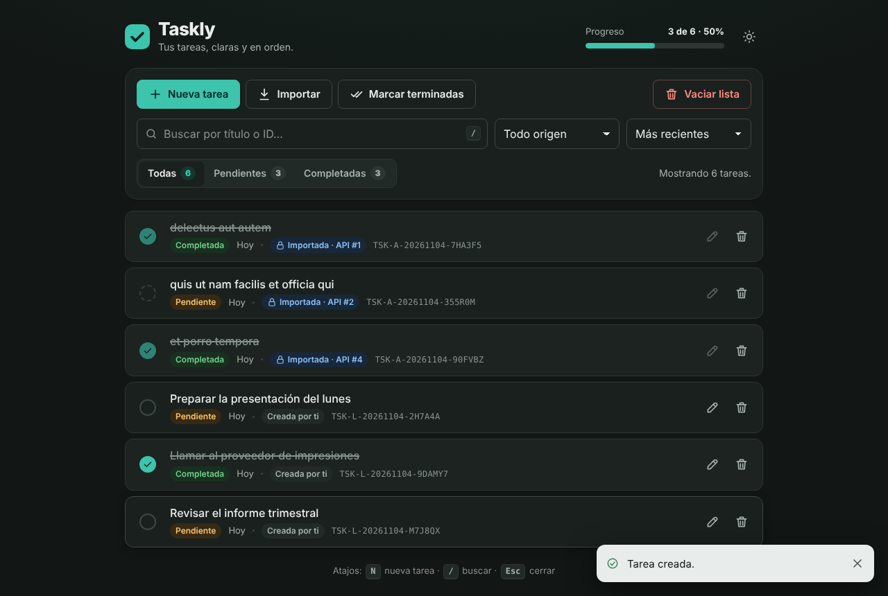 | 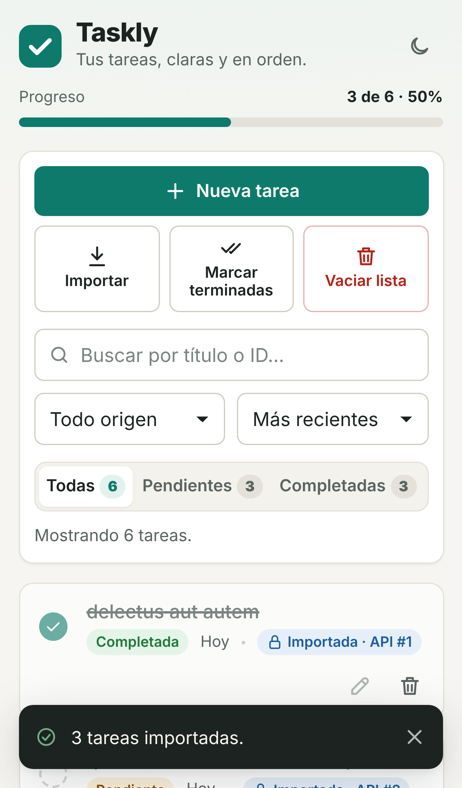 | 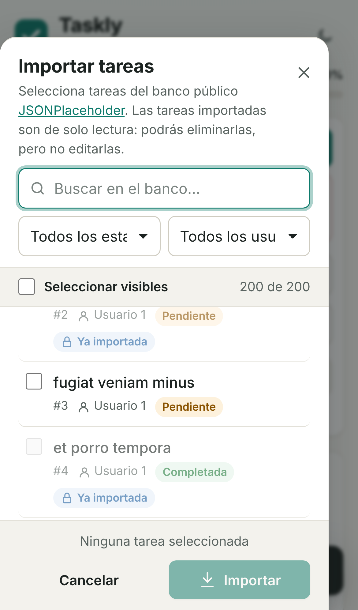 |

| Formulario | Importar | Búsqueda |
|---|---|---|
| 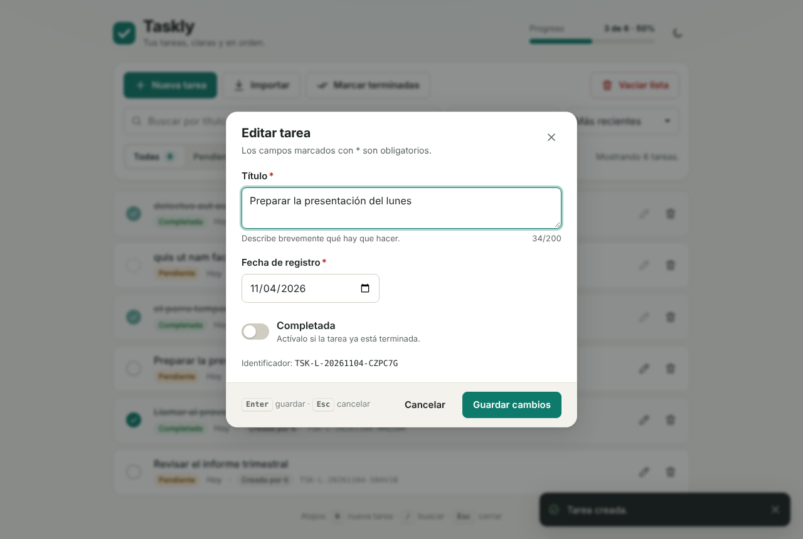 | 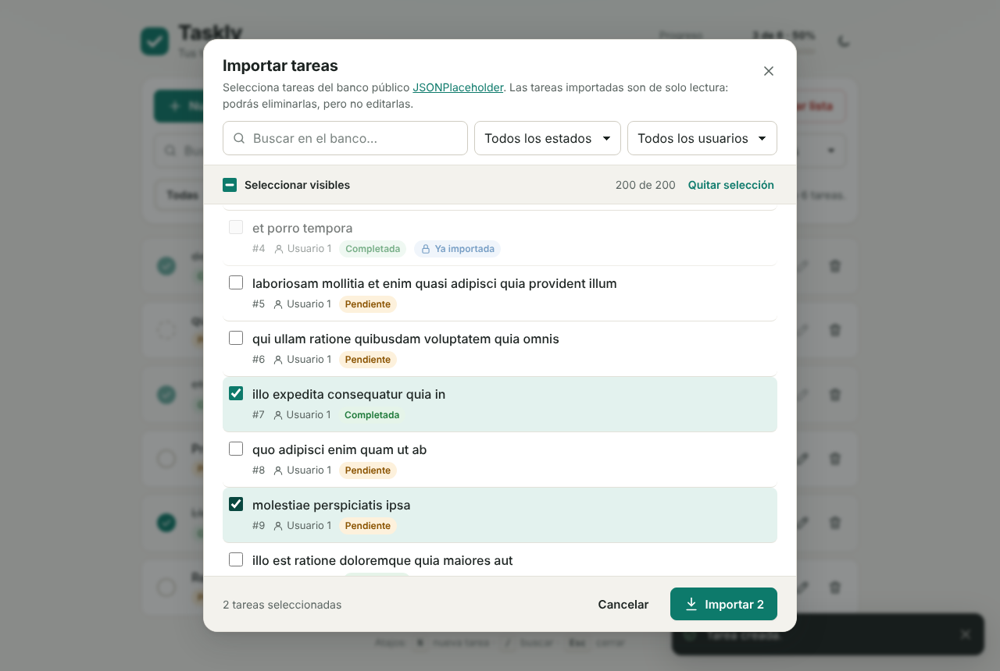 | 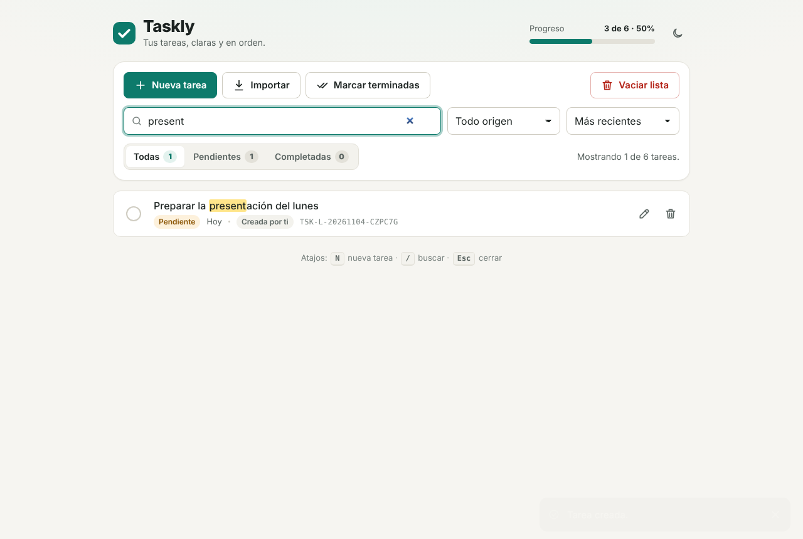 |

---

## Wireframes

Los wireframes de baja fidelidad están en [`docs/wireframes/wireframes.html`](docs/wireframes/wireframes.html) (se abren directamente en el navegador) y exportados como imagen:

| | |
|---|---|
| 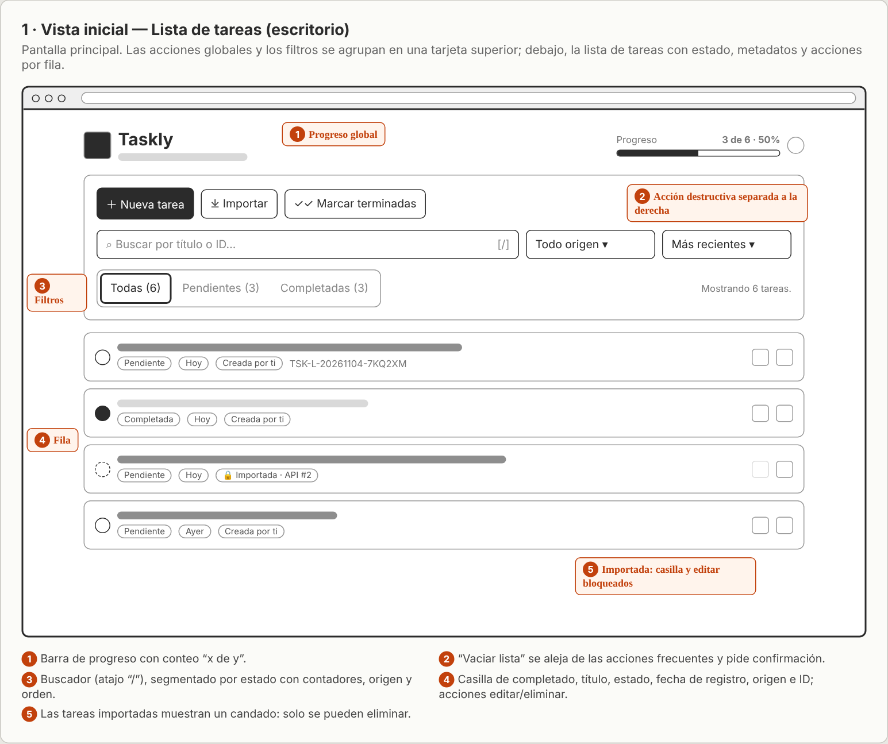 | 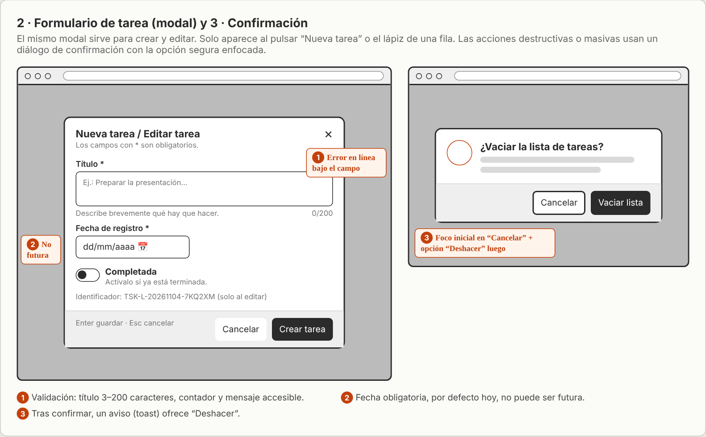 |
| 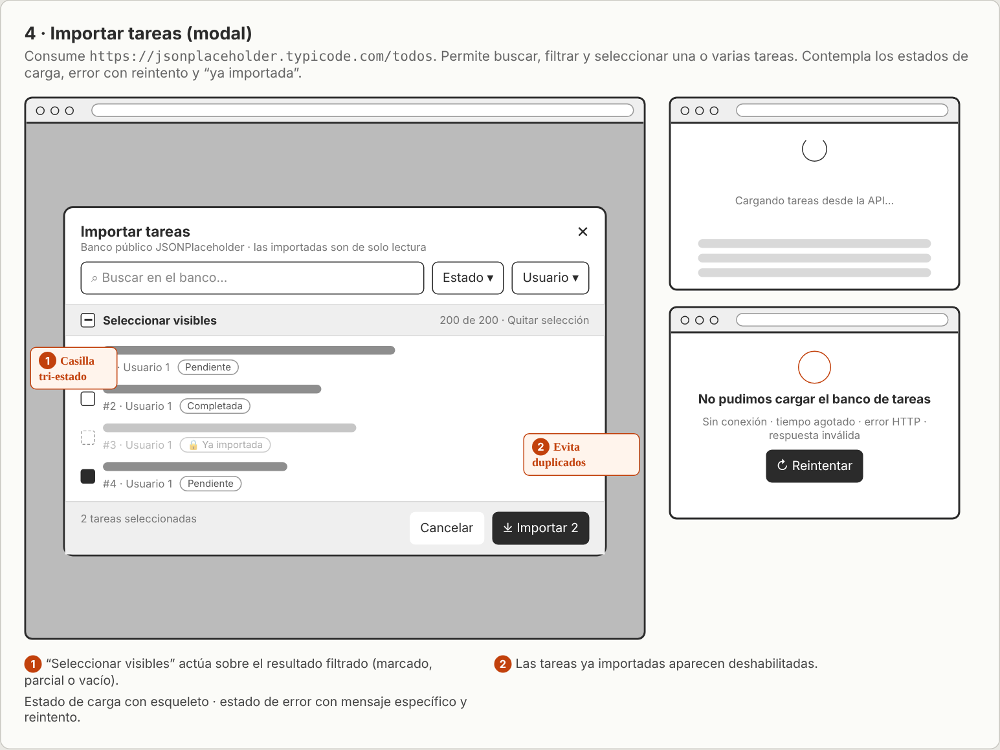 | 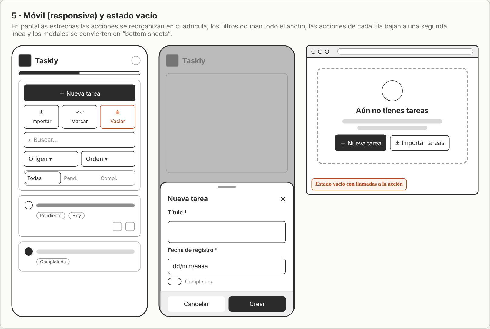 |

1. **Lista de tareas (escritorio):** jerarquía de acciones, filtros y anatomía de la fila.
2. **Formulario y confirmación:** campos, validación y diálogo destructivo.
3. **Importar:** selección múltiple, tareas ya importadas, estados de carga y error.
4. **Móvil y estado vacío:** reorganización responsive y *bottom sheet*.

---

## Compatibilidad

Navegadores modernos (versiones de 2023 en adelante) con soporte de Custom Elements v1, Shadow DOM, módulos ES, `<dialog>`, campos privados de clase y `color-mix()`: Chrome/Edge 111+, Firefox 113+ y Safari 16.4+. Si `adoptedStyleSheets` no está disponible, se recurre automáticamente a etiquetas `<style>`.
